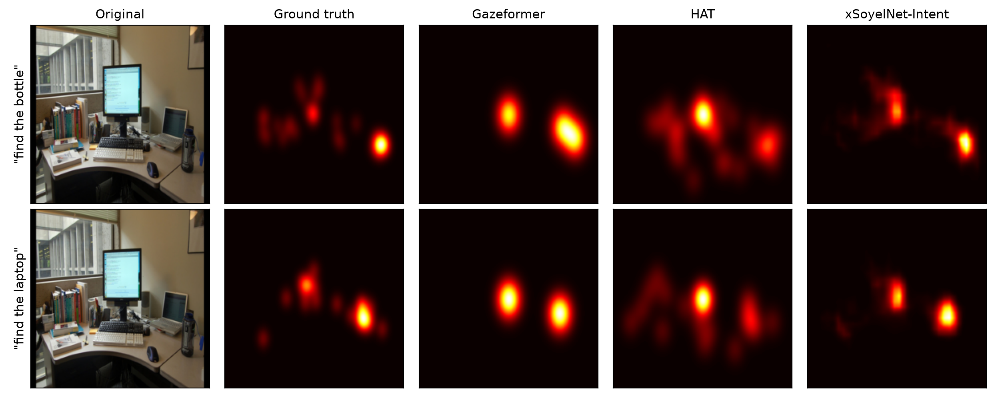

# Say What You Seek

Code and results for:

> Hamit Soyel. **Say What You Seek: A 1.5M-Parameter Readout on Frozen Features Beats
> Scanpath Transformers at Goal-Directed Fixation Prediction.** IEEE Signal Processing
> Letters (submitted).

## The result in one paragraph

**xSoyelNet-Intent** predicts a goal-conditioned fixation-density map from an image and
a free-text goal ("find the bottle"). It pairs a frozen DINOv2-base backbone with a
frozen CLIP text encoder and trains only a 1.5M-parameter FiLM-modulated ASPP readout
(zero-initialized FiLM, so the model starts unconditional and learns the conditioning
delta), plus a learned center bias and a train-selected Gaussian finalizer. On
COCO-Search18 target-present search it reaches **CC 0.837 / NSS 4.24 / AUC 0.935**,
exceeding the official **Gazeformer (CC 0.738)** and **HAT (CC 0.672)** models evaluated
as density predictors under an identical protocol with each given its *most favorable*
scanpath-to-density conversion. Conditioning is grounded: correct goal 0.837, no goal
0.635, wrong goal 0.524. Training takes under 30 minutes on one consumer GPU.



## Reproduction

1. **Get COCO-Search18 target-present data** (not redistributed here):
   https://sites.google.com/view/cocosearch/ (you need the TP images and the
   `coco_search18_fixations_TP_{train,validation}_split*.json` files under
   `data/cocosearch18/`).
2. `pip install -r requirements.txt`
3. Build density maps and train/val pairs, then train and evaluate:

```bash
python process_cocosearch18.py     # fixations -> per-(image,target) density maps + splits
python train.py                    # ~30 min on one GPU; prints val CC vs the baselines
python eval_ablations.py           # correct / no-goal / wrong-goal + clean-val numbers
python eval_nss_auc.py             # NSS/AUC against discrete fixation points
```

Pre-computed result JSONs for every number in the paper are in `results/`.

## Baseline conversion (Gazeformer / HAT)

`baseline_gazeformer_density.py` and `baseline_gazeformer_sigma_sweep.py` evaluate the
official Gazeformer checkpoint (from its own release; see the Gazeformer repo for the
checkpoint and precomputed features, expected under `gazeformer_assets/` with the repo
under `gazeformer_repo/`) as a density predictor, sweeping the density-conversion
bandwidth in the baseline's favor. `baseline_hat_gpu_eval.py` is the
GPU-environment script used to run HAT (its MSDeformAttn ops require CUDA); it documents
the exact dependency pins needed in 2026 (detectron2 v0.6, pillow<10, timm 0.6.12, and
`stages.`-prefix key remaps for both the M2F backbone pickle and the HAT_TP checkpoint).
`baseline_hat_sigma_sweep.py` re-scores HAT's saved raw fixation points
(`results/hat_raw_points.json`, included) under the bandwidth sweep.

**Two pitfalls worth knowing** (both cost us a debugging round and are documented in the
paper): HAT's decoder returns *(x, y)* normalized coordinates while Gazeformer returns
*(y, x)* pixel coordinates, and conflating them silently halves HAT's score; and the
scanpath-to-density bandwidth changes baseline CC by up to 0.07, which is why every
reported baseline number uses that baseline's best bandwidth.

## Repository layout

```
model.py                            xSoyelNet-Intent (self-contained)
train.py                            train + evaluate (prints CC vs baselines)
eval_ablations.py                   conditioning ablations + clean-val
eval_nss_auc.py                     NSS/AUC from rebuilt fixation points
process_cocosearch18.py             dataset preparation
baseline_gazeformer_density.py      Gazeformer as density predictor (our protocol)
baseline_gazeformer_sigma_sweep.py  bandwidth steelman sweep
baseline_hat_gpu_eval.py            HAT on a CUDA GPU (documented dependency pins)
baseline_hat_sigma_sweep.py         HAT bandwidth steelman from saved raw points
make_fig_conditioning.py            Fig. 1
results/                            pre-computed JSONs backing every number
figures/                            pre-rendered paper figure
```

## License / data

- Code: MIT (see `LICENSE`).
- **COCO-Search18 images and fixation data are NOT redistributed**: obtain them from
  the dataset's release page and observe its terms. This repo contains only code,
  derived aggregate results, and HAT's predicted fixation points (model outputs).
- Gazeformer and HAT checkpoints come from their authors' own releases; used here for
  benchmarking.
